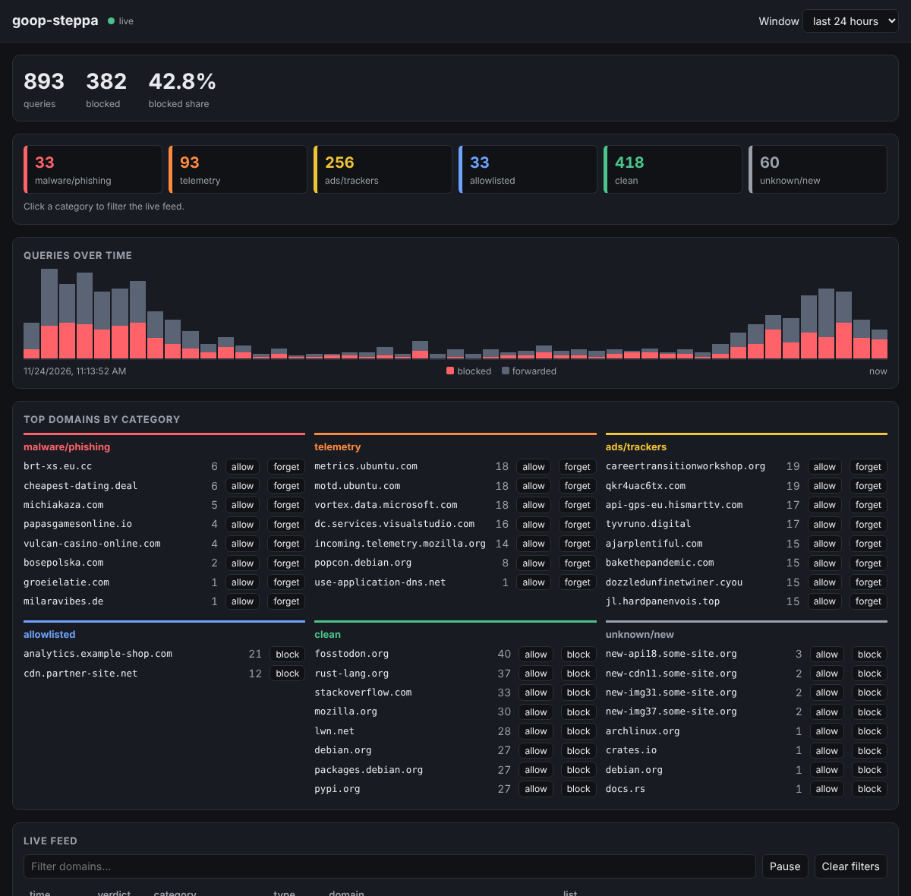
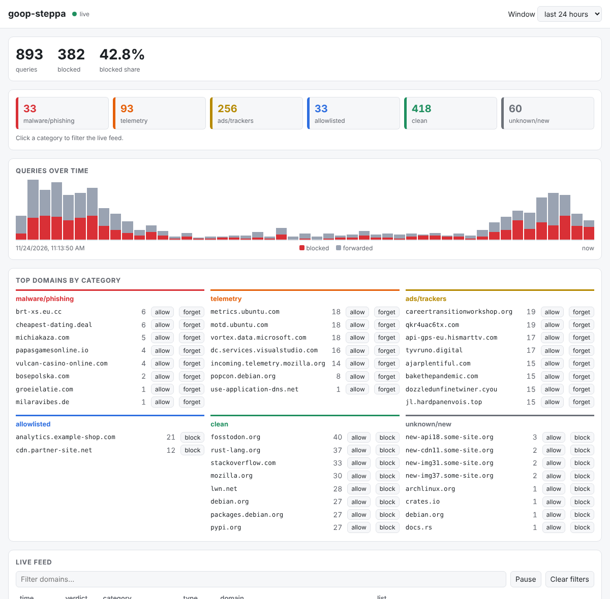

# goop-steppa

A local DNS privacy monitor for Linux. Think of it as a local NextDNS crossed with Wireshark:
it blocks telemetry, ads, trackers and malicious domains the way Brave does, but unlike Brave it
**shows you everything it sees** in a clear, color-coded report instead of blocking silently.

- Runs a DNS resolver on `127.0.0.1` and forwards allowed queries to an **encrypted upstream**
  (DoH or DoT; Quad9 by default).
- Checks every query against blocklists. Blocked names get `0.0.0.0` / `::` back.
- Logs every query (time, domain, type, verdict, category, which list decided).
- Shows it three ways: a CLI `report`, a live terminal view, and a local web dashboard.
- `scan <file>` pulls every URL and domain out of a file and judges it with the same lists,
  without opening or executing anything.
- **No accounts, no API keys, no cloud service.** Everything is local except the lists you choose to
  download and the upstream resolver you choose to use.



<details><summary>Light mode</summary>



</details>

*Screenshots use generated sample data, not real browsing.*

## Colors

| Color  | Meaning                                         |
|--------|-------------------------------------------------|
| red    | malware / phishing                              |
| orange | telemetry                                       |
| yellow | ads / trackers                                  |
| blue   | on **your** allowlist                           |
| green  | clean (no list objects, and you've seen it before) |
| grey   | unknown: no list has an opinion **and** it's the first time you've seen it |

Every color also has a text label, so output stays readable without color (`NO_COLOR` and
`--color never` are honored). *Green does not mean "verified safe"*: it means no list flags the
domain. Grey is simply "new to you".

## Install

Requires Linux, a stable Rust toolchain (<https://rustup.rs>) and a C compiler (SQLite is bundled and
compiled from source).

```sh
git clone https://github.com/noisyloop/goop-steppa
cd goop-steppa
cargo install --path .          # installs ~/.cargo/bin/goop-steppa
```

Or just build and run in place: `cargo build --release && ./target/release/goop-steppa --help`.

## Quick start (no root needed)

Port 53 needs privileges, so try it on a high port first:

```sh
goop-steppa lists update              # download the configured blocklists (first run only; ~5 s)
goop-steppa run --port 5353           # start the resolver + dashboard
```

In another terminal:

```sh
dig @127.0.0.1 -p 5353 example.com    # normal lookup, forwarded over DoH
dig @127.0.0.1 -p 5353 motd.ubuntu.com # blocked: answers 0.0.0.0
goop-steppa report                    # what happened, in color
goop-steppa tui                       # live terminal view
xdg-open http://127.0.0.1:8053/       # web dashboard
```

On first run goop-steppa writes `~/.config/goop-steppa/config.toml` and a starter list at
`~/.config/goop-steppa/lists/linux-telemetry.txt`. Data (history, downloaded lists) lives in
`~/.local/share/goop-steppa/`.

## Making your system use it

Nothing changes on your machine until you ask. There are two ways.

### Option A: `goop-steppa setup` (systemd-resolved; reversible)

Ubuntu and Fedora use systemd-resolved by default; on Debian and Arch it is optional (check with `systemctl is-active systemd-resolved`).

```sh
goop-steppa run --port 5353 &          # it must be running first
goop-steppa setup --port 5353          # DRY RUN: shows what it detected and exactly what it would do
sudo goop-steppa setup --apply --port 5353
goop-steppa setup --verify             # proves queries from the system resolver reach goop-steppa
```

What `--apply` does, in full:

1. Refuses unless something is actually answering DNS on `127.0.0.1:<port>` (so it can't leave you without DNS by accident).
2. Writes **one new file**: `/etc/systemd/resolved.conf.d/goop-steppa.conf`
   ```ini
   [Resolve]
   DNS=127.0.0.1:5353
   Domains=~.
   DNSOverTLS=no
   ```
3. Runs `systemctl restart systemd-resolved` (and rolls the file back if that fails).

No existing file is edited. A custom port needs systemd >= 247; on older versions run goop-steppa
on port 53 instead. It refuses to overwrite or remove a file it didn't create.

### Revert (fully reversible)

```sh
sudo goop-steppa setup --revert
```

That deletes the one file and restarts systemd-resolved. By hand, with no goop-steppa at all:

```sh
sudo rm /etc/systemd/resolved.conf.d/goop-steppa.conf
sudo systemctl restart systemd-resolved
```

> **If goop-steppa isn't running while it is applied, name resolution on the machine fails**, because
> it is the only DNS server configured. Either keep it running as a service (below) or revert before
> stopping it. The manual revert above works even when goop-steppa is broken or uninstalled.

### Option B: manual / not using systemd-resolved

Run goop-steppa on port 53 (`sudo setcap 'cap_net_bind_service=+ep' $(command -v goop-steppa)` lets a
normal user bind it) and point your resolver at `127.0.0.1`, for example in NetworkManager set the
connection's DNS to `127.0.0.1` and ignore DHCP DNS. `goop-steppa setup` (no flags) prints guidance
for systems without systemd-resolved. To undo, restore the previous DNS setting.

### Run it as a service

A user service with lingering starts at boot and shares your normal config and data directories
(`~/.config/goop-steppa` and `~/.local/share/goop-steppa`), so the `block`, `allow`, `tui` and `report` commands work
against the running instance:

```ini
# ~/.config/systemd/user/goop-steppa.service
[Unit]
Description=goop-steppa DNS privacy monitor

[Service]
ExecStart=%h/.cargo/bin/goop-steppa run --port 5353
Restart=on-failure

[Install]
WantedBy=default.target
```

```sh
systemctl --user daemon-reload
systemctl --user enable --now goop-steppa
sudo loginctl enable-linger "$USER"      # start at boot, not just at login
```

### Browsers

- **Firefox:** goop-steppa answers NXDOMAIN for the canary `use-application-dns.net`, which tells
  Firefox to turn off its built-in DoH and use the system resolver.
- **Chrome / Brave / Edge:** these can ship their own "Secure DNS" and **bypass local DNS entirely**.
  Turn it off (Settings -> Privacy and security -> Security -> *Use secure DNS*) or their lookups will
  never appear in goop-steppa. The report and dashboard remind you of this.

## Using it

### `report`

```
$ goop-steppa report --since 24h --top 4

goop-steppa report  (last 24h)

893 queries, 382 blocked (42.8%)

By category
  malware/phishing       33  ██                        blocked
  telemetry              93  █████                     blocked
  ads/trackers          256  ███████████████           blocked
  allowlisted            33  ██                        forwarded
  clean                 418  ████████████████████████  forwarded
  unknown/new            60  ███                       forwarded

Top telemetry
  metrics.ubuntu.com                18
  motd.ubuntu.com                   18
  vortex.data.microsoft.com         18
  dc.services.visualstudio.com      16
  ...
Blocked by list
  Hagezi Pro                              256
  Linux telemetry (starter)                92
  Hagezi threat intelligence (medium)      33
```

(abridged; sample data). Options: `--since 30m|24h|7d|all`, `--top N`, `--recent N`,
`--category/-c malware|telemetry|ads|allowed|clean|unknown`, `--color auto|always|never`.

### Live terminal view

`goop-steppa tui` attaches to a running instance (it tails the query history);
`goop-steppa run --tui` runs the resolver and the view together (logs go to
`~/.local/share/goop-steppa/goop-steppa.log`).

| Key | Action |
|-----|--------|
| `↑↓` / `j k`, `PgUp/PgDn` | move; scrolling away from the top pauses the feed |
| `g` / `G` | jump to newest (resume following) / oldest |
| `space` / `p` | pause or resume |
| `1`-`6` | toggle category filters (malware, telemetry, ads, allowlisted, clean, unknown) |
| `/` | text search, `0` clears all filters |
| `b` | block the selected domain (keeps its category; ads if it had none) |
| `a` | allow the selected domain |
| `u` | forget: remove it from your block **and** allow lists |
| `?` / `q` | help / quit |

Block and allow apply to the domain and all its subdomains, and a running instance picks the change up
within about two seconds.

### Web dashboard

`goop-steppa run` also serves `http://127.0.0.1:8053/` (change `[web] port`, or `--no-web`). It has a
live feed, totals, per-category counts (click to filter), a blocked-vs-forwarded chart over time, top
domains per category, and allow/block/forget buttons. It is bound to **127.0.0.1 only** (not
configurable) and has no login, so anyone with a local account on a shared machine can open it.

### Blocking, allowing, lists

```sh
goop-steppa block ads.example.com               # also blocks every subdomain
goop-steppa block https://t.example.net/x -c telemetry
goop-steppa allow example.com                   # the allowlist always wins
goop-steppa forget example.com                  # remove from both of your lists
goop-steppa check motd.ubuntu.com github.com    # what would happen? (no network)
goop-steppa lists update                        # refresh now (also refreshed every 24 h while running)
goop-steppa lists show
```

```
$ goop-steppa check motd.ubuntu.com ads.example.org
motd.ubuntu.com: blocked / telemetry (Linux telemetry (starter))
ads.example.org: allowed / clean (-)
```

Your own lists are plain text files you can edit: `~/.config/goop-steppa/blocklist.txt`
(`domain [category]` per line) and `allowlist.txt`.

**Matching rules**

1. Your allowlist always wins, and allowing `example.com` allows `a.b.example.com` too.
2. Otherwise the most specific blocklist match wins (blocking `example.com` blocks `a.example.com`, but not `notexample.com`).
3. If a domain is in several lists, the most severe category wins (malware > telemetry > ads).

### `scan <file>`

```
$ goop-steppa scan notes.txt

goop-steppa scan  notes.txt  (text, 251 B)

4 domains found, 3 flagged
1 malware/phishing   1 telemetry   1 ads/trackers   0 allowlisted   1 clean   0 unknown/new

  BLOCK malware/phishing  d3tjml0i5ek35w.cloudfront.net     2  Hagezi threat intelligence (medium)
        http://d3tjml0i5ek35w.cloudfront.net/update.bin
        https://d3tjml0i5ek35w.cloudfront.net/gate.php?id=7
  BLOCK telemetry         motd.ubuntu.com                   1  Linux telemetry (starter)
  BLOCK ads/trackers      errors.2brands.de                 1  Hagezi Pro
  ok    clean             github.com                        1
```

It reads the file **as bytes only**: nothing is opened, executed or fetched, and devices/FIFOs are refused.
It handles plain text, HTML (entities), PDFs (compressed streams, plus text stored as font glyph IDs,
decoded through each font's `ToUnicode` map), and binaries (ASCII and UTF-16LE strings like
`strings`). It also recovers defanged indicators (`hxxp://evil[.]com`, `(dot)`) and percent-encoded URLs.
Bare names need a real TLD (`kernel32.dll`, `install.sh` are not domains); names with file-like TLDs such
as `.sh`, `.py`, `.zip` count only inside an explicit URL. IP-address URLs are listed but not judged.

Options: `--flagged`, `--all`, `--json`, `--max-size MiB`, `--color`, and several files at once.

**Limits:** it does not undo base64/XOR obfuscation, unpack zip-based containers (docx, jar, apk), or
decode PDF text that uses other filters; it judges the domains a file *mentions*, not what the file does.

## Configuration

`~/.config/goop-steppa/config.toml` (the shipped default is `config/default.toml`):

| Section | Keys |
|---------|------|
| `[server]` | `listen` (default `127.0.0.1`), `port` (default `53`; use e.g. `5353` unprivileged) |
| `[upstream]` | `protocol` = `doh` / `dot` / `udp` (plain, testing only), `servers`, `tls_name`, `doh_path` |
| `[filter]` | `refresh_hours` (default 24, `0` = never) |
| `[storage]` | `path` (history DB), `retention_days` (default 30, `0` = keep forever) |
| `[web]` | `enabled`, `port` (default 8053) |
| `[[lists]]` | `name`, `url` **or** `path` (absolute or relative to the config dir), `category` = `malware`/`telemetry`/`ads`, `enabled` |

Lists are **not hardcoded**: the default config just ships sensible public ones, all free downloads
needing no account:

| List | Category |
|------|----------|
| URLhaus malware hosts (abuse.ch) | malware |
| Hagezi threat intelligence (medium) | malware |
| Linux telemetry (starter): a short local file | telemetry |
| EasyPrivacy | ads |
| Hagezi Pro | ads |

Hosts, adblock (`||domain^`) and plain-domain formats are auto-detected. Windows telemetry
(WindowsSpyBlocker) is included as a commented-out example for WSL/Wine/VM traffic.

The **Linux telemetry starter list** is short and conservative (Ubuntu, Debian, Firefox and Microsoft
developer-tool endpoints). It was written from known public endpoints and has not been checked against
your traffic, so treat it as a starting point: find more candidates with
`goop-steppa report -c unknown --top 50` and add them to your own blocklist.

## Troubleshooting

- **Nothing shows up after `setup --apply`**: run `goop-steppa setup --verify`. If it says queries aren't
  reaching goop-steppa, a per-link DNS server (DHCP/NetworkManager) is probably taking precedence.
  Inspect with `resolvectl status`, then stop that link competing for default routing:
  `sudo resolvectl default-route <link> no` (not persistent; make it permanent in your network manager).
- **"address in use" / "permission denied"**: use `--port 5353`, or `setcap` as above. systemd-resolved
  owns `127.0.0.53:53`, not `127.0.0.1:53`.
- **DNS is broken after stopping goop-steppa**: revert (see above), or restart goop-steppa.
- **A list failed to download**: `goop-steppa lists update` names it; cached copies keep working, and the
  other lists are unaffected.
- **Something is wrongly blocked**: `goop-steppa allow <domain>` (immediate, and always wins).

## Security notes

- The dashboard checks the `Host` header (DNS rebinding), requires a custom header + JSON content type +
  matching `Origin` for any change (CSRF), sends a strict CSP, and only ever renders domains with
  `textContent`. Query names are attacker-influenced (any web page can make your machine look one up), so
  they are also sanitized before being stored or printed.
- goop-steppa does **not** perform DNSSEC validation; it trusts your encrypted upstream for answers.
- Blocking is only as good as the lists and only covers apps that use your system resolver.

## Project layout

```
src/main.rs            entry point, command dispatch
src/cli.rs             clap definitions
src/config.rs          TOML config, XDG paths, shipped defaults
src/category.rs        categories, verdicts      src/theme.rs   the color palette
src/dns/               server.rs (resolver), upstream.rs (DoH/DoT), attribution.rs (future seam)
src/filter/            engine.rs (matching), parse.rs (hosts/adblock), mod.rs (lists, user files)
src/event.rs           query events and the "first time seen" logic
src/store.rs           SQLite history          src/report.rs  colored report
src/tui.rs             ratatui live view       src/web/       axum dashboard (+ html/js/css)
src/scan/              file scanner            src/system.rs  systemd-resolved setup/revert
config/                default.toml and the starter list
```

**Per-application attribution** (which process made which query) is out of scope for v1. The seam is
`src/dns/attribution.rs`: a `ProcessAttributor` trait (client socket -> process) that the DNS handler holds.
An eBPF implementation can be plugged in there later without changing the rest of the pipeline.

## Status: what has and hasn't been verified

`cargo test` runs ~100 unit tests covering matching and precedence, list parsing, the history store, the
report, TUI state and rendering, the dashboard's security checks and endpoints, scanning (including
seeded fuzzing), and the setup/revert logic.

Verified end to end during development: forwarding over UDP and TCP, blocking and hot-reload of your
lists, history and `report`, the dashboard in a real browser, `scan` on a real binary and PDF, and
downloading real lists. **Not verified in the development environment** (it had no direct internet access
and no systemd-resolved):

- DoH/DoT to a real upstream (Quad9) was never exercised there. Forwarding was tested against a local
  stand-in upstream. Please test `dig` against a real run on your machine and report problems.
- `setup --apply` / `--revert` were tested against a faked systemd and filesystem, not a live
  systemd-resolved.
- The URLhaus and EasyPrivacy default list URLs were unreachable from that environment.
- The systemd user-service example is standard syntax but untested.

## Development

```sh
cargo test
cargo build --release
```

## License

MIT, see [LICENSE](LICENSE).
